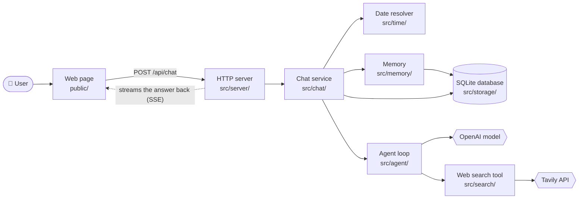
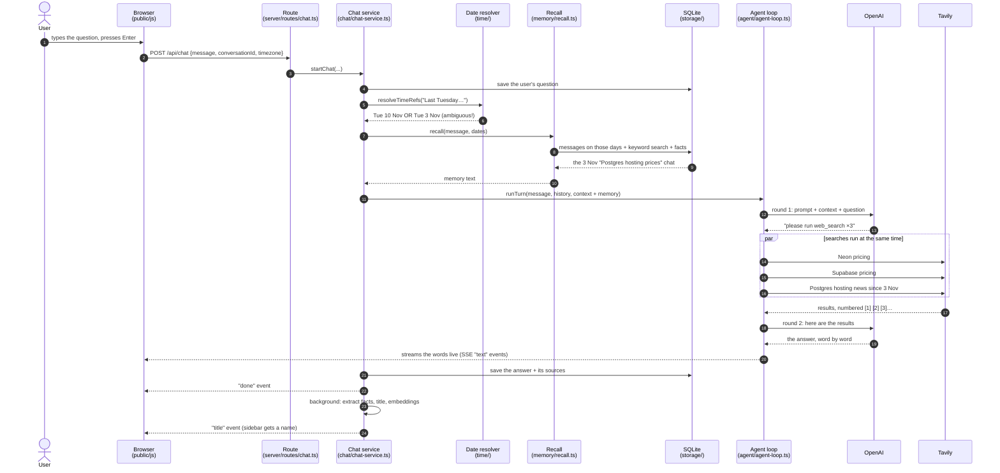
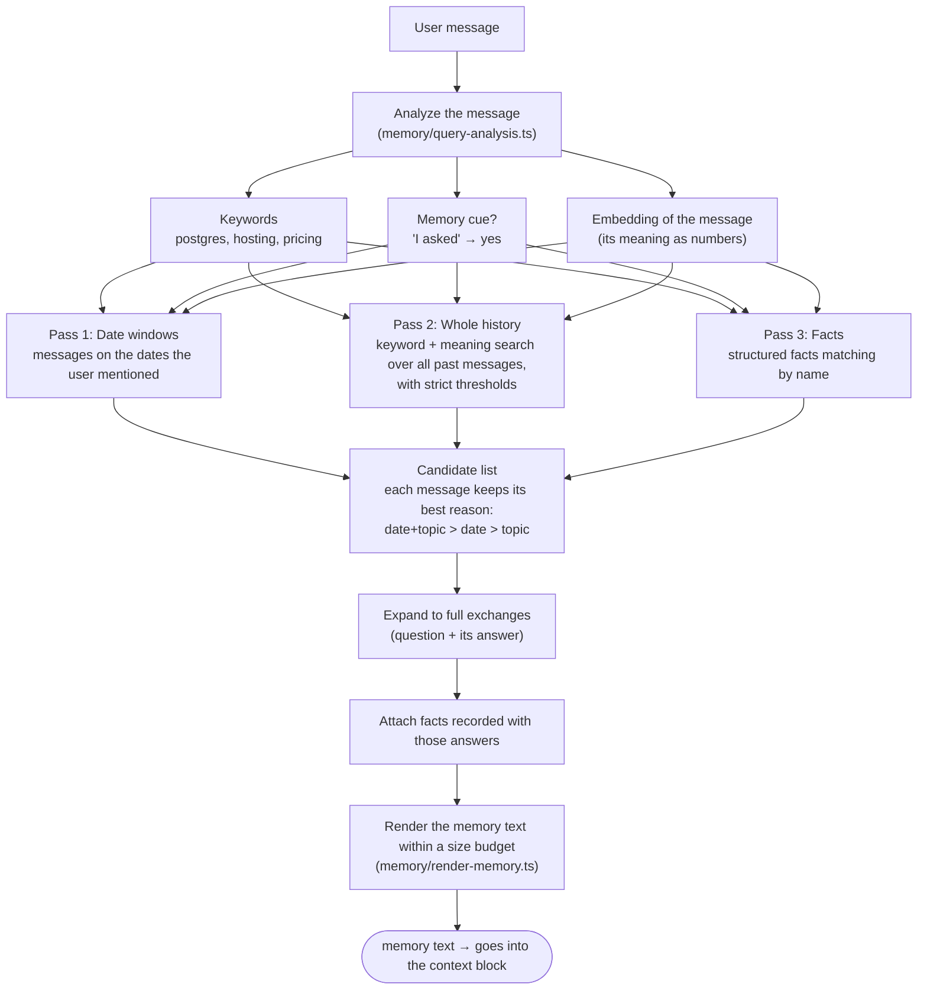
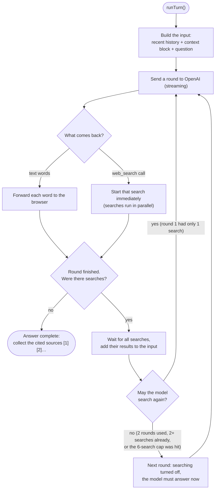
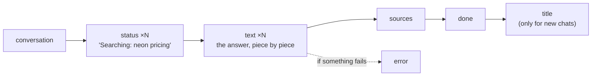
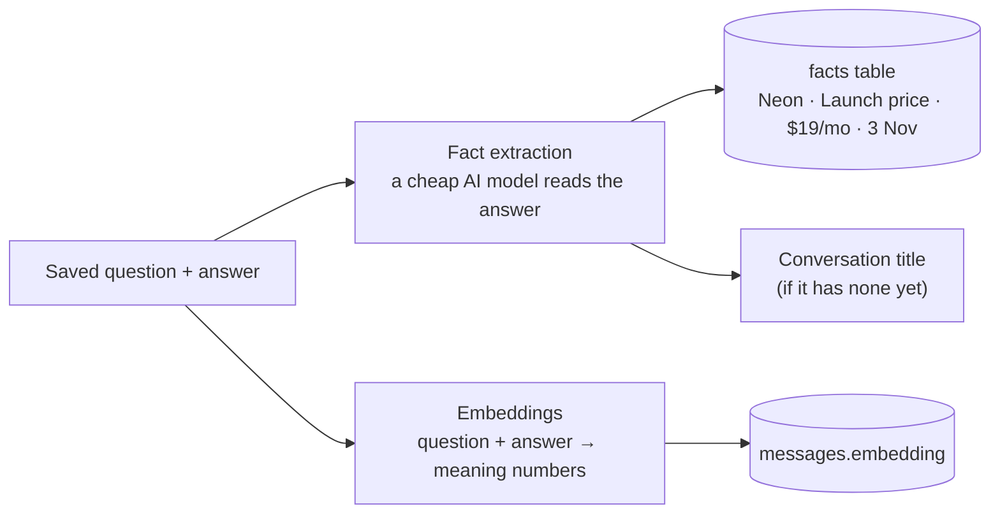
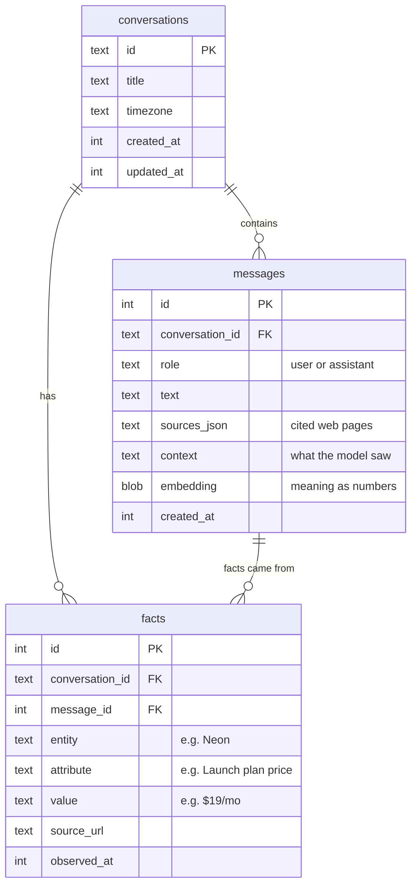
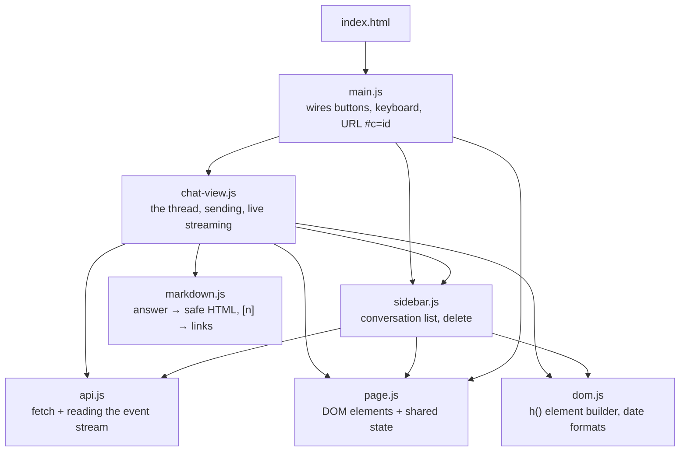
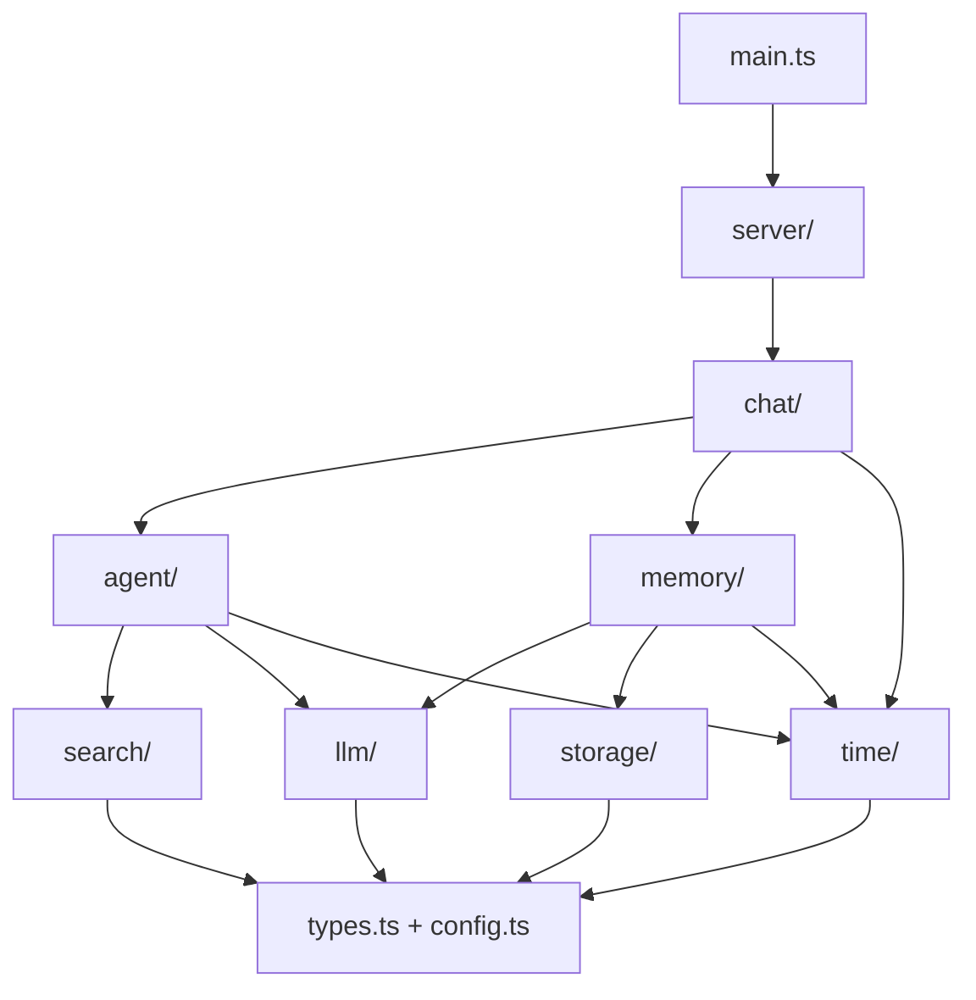

# Minimi: a guide to the codebase for complete beginners

This guide assumes you know nothing about the project. Read it top to bottom once, and you
should be able to open any file and know where it fits.

> The diagrams are written in [Mermaid](https://mermaid.js.org/). GitHub draws them as graphs
> automatically. In VS Code, open the Markdown preview (`Cmd+Shift+V`). If you see code
> instead of a picture, install the "Markdown Preview Mermaid Support" extension.

---

## 1. What does this app do?

Minimi is a chat assistant, like a small ChatGPT, with two special abilities:

1. **It can search the web** to answer questions about things that change: prices, releases, news.
2. **It remembers your past conversations by date.** You can ask:
   *"Last Tuesday I asked you about Postgres hosting. Has the pricing changed since?"*
   Minimi works out which day "last Tuesday" was and finds what you discussed then. Then it
   searches the web for today's prices and tells you what changed.

**An analogy.** Think of Minimi as a research assistant with a diary.
- The **diary** is the database, holding every past conversation with its date.
- Before answering, the assistant **flips through the diary** for relevant pages. That's
  memory recall.
- Then it **goes to the library**, which here is the web search tool.
- It **writes the answer**, using the AI model (OpenAI).
- Afterwards, it **writes key facts into the diary's index**, such as "Neon costs $19/month as
  of 3 Nov". That's background enrichment.

---

## 2. Words you will see everywhere

| Word | Plain meaning |
|---|---|
| **LLM / model** | The AI that writes text (here an OpenAI GPT model). We send it text; it sends text back. |
| **Prompt** | The text we send the model. The **system prompt** is the fixed rulebook (`agent/prompt.ts`). |
| **Tool** | A function the model is allowed to ask us to run. Minimi has exactly one: `web_search`. |
| **Turn** | One user message plus the assistant's full answer. |
| **Round** | One trip to the model inside a turn. If the model asks for a search, we run it and do another round. |
| **Streaming** | The answer arrives word by word instead of all at once, so the user sees it immediately. |
| **SSE (server-sent events)** | The way the server pushes those words to the browser over one open HTTP connection. |
| **SQLite** | A database that lives in a single file (`data/minimi.db`). No database server needed. |
| **FTS (full-text search)** | Keyword search inside the database, like Ctrl+F but ranked by relevance. |
| **Embedding** | A list of numbers that represents the *meaning* of a text. Similar meanings give similar numbers, so "CRM tools" can match "customer relationship software". |
| **Recall** | Our code that searches past conversations *before* the model runs. |
| **Context block** | The extra text we put in front of the user's message: current time, resolved dates, recalled memory. |
| **Tavily** | The web search service we call. |

---

## 3. The big picture



There are three outside services, and everything else runs on your machine:
- **OpenAI** writes answers, extracts facts and makes embeddings.
- **Tavily** searches the web.
- **SQLite** is just a local file.

---

## 4. The folders, and what lives in each

```
minimi/
├── src/                     ← the server (TypeScript, runs on Node.js)
│   ├── main.ts              ← START HERE: starts everything
│   ├── config.ts            ← reads settings from .env (API keys, model names)
│   ├── types.ts             ← the shapes of our data (Message, Fact, …)
│   │
│   ├── server/              ← receives HTTP requests from the browser
│   ├── chat/                ← handles one chat message from start to finish
│   ├── agent/               ← talks to the AI model (prompt + the search loop)
│   ├── memory/              ← finds relevant past conversations; saves new facts
│   ├── search/              ← the web search tool (Tavily)
│   ├── time/                ← turns "last Tuesday" into real dates
│   ├── llm/                 ← the OpenAI connection, shared by everyone
│   └── storage/             ← the database (SQLite): tables and queries
│
├── public/                  ← the web page (HTML, CSS, JavaScript for the browser)
├── scripts/                 ← helper commands (demo data, terminal chat, speed test)
└── test/                    ← automated tests (use a fake AI, no internet needed)
```

### "I want to change X, where do I look?"

| I want to… | Open this file |
|---|---|
| Change how the assistant talks or behaves | `src/agent/prompt.ts` (the system prompt) |
| Change how many searches it may do | `src/config.ts` (`maxSearchesPerTurn`) and `src/agent/agent-loop.ts` |
| Change which AI model is used | `.env` → `OPENAI_MODEL` (default in `src/config.ts`) |
| Support a new date phrase ("fortnight ago") | `src/time/resolve-time-refs.ts` (the `RULES` list) |
| Tune what past conversations get remembered | `src/memory/recall.ts` and `src/memory/ranking.ts` |
| Change what search returns | `src/search/web-search.ts` |
| Add a database column or table | `src/storage/schema.ts` and the store file for that table |
| Add an API endpoint | `src/server/routes/` |
| Change the look of the page | `public/style.css` |
| Change how the chat page behaves | `public/js/chat-view.js` |

---

## 5. The journey of one message (the most important section)

Let's follow a real question from the keyboard to the screen:

> **"Last Tuesday I asked about Postgres hosting. Has pricing changed?"**
> (asked on Wednesday 11 Nov 2026, from India)

### 5.1 The whole journey in one picture



### 5.2 The same journey, step by step

**Step 1: the browser sends the message.**
`public/js/chat-view.js`, function `send()`.
The page sends the text, the current conversation id and your timezone (for example
`Asia/Kolkata`) to the server. It then keeps the connection open to receive the answer as it's
written.

**Step 2: the server checks the request.**
`src/server/routes/chat.ts`.
It checks that the API keys exist and the message isn't empty, then hands the request to the
chat service. It also sets up streaming: each event the chat service emits is written to the
open connection.

**Step 3: the chat service takes over.**
`src/chat/chat-service.ts`, functions `startChat()` and `runChat()`.
This is the conductor. It:
- creates the conversation if it's new,
- *locks* it, so you can't send a second message while the first is being answered,
- saves your question to the database first, so it's never lost.

**Step 4: dates are worked out in code, not by the AI.**
`src/time/resolve-time-refs.ts`, function `resolveTimeRefs()`.
"Last Tuesday", said on Wednesday 11 Nov, could mean yesterday (10 Nov) or the week before
(3 Nov). The code does **not** guess. It returns both:
```
"Last Tuesday" → Tue 10 Nov 2026 | Tue 3 Nov 2026
```
It works through a list of regex rules (`RULES`) such as "N days ago", "last week" and
"Monday", plus a library (chrono) for dates like "3 November".

**Step 5: memory recall searches past conversations.**
`src/memory/recall.ts`, function `recall()`. Explained in detail in section 6.
It finds that 3 Nov had a conversation about Postgres prices, and that 10 Nov only had an
unrelated one about a Lisbon trip.

**Step 6: the context block is built.**
`src/agent/prompt.ts`, function `buildContext()`.
This is the actual text placed in front of your question:
```
<context>
Current time: Wednesday 11 Nov 2026, 12:30 (Asia/Kolkata, UTC+05:30)
Dates referred to in the message:
- "Last Tuesday" is ambiguous: Tue 10 Nov 2026 [2026-11-10] or Tue 3 Nov 2026 [2026-11-03]
<memory>
## Date checks
- Tue 10 Nov 2026 ("Last Tuesday"): 1 conversation ("Weekend in Lisbon") — nothing about this topic.

## Past exchanges (times in Asia/Kolkata)
### Tue 3 Nov 2026, 10:00 · "Managed Postgres hosting prices" (matches the date and topic)
User: I need managed Postgres hosting for a small SaaS … Compare Neon, Supabase, Render and AWS RDS on price.
Assistant: | Neon | Launch | $19/mo | … [1] …
## Facts recorded in past answers (true as of the date shown)
- Neon · Launch plan price: $19/mo (recorded Tue 3 Nov 2026, https://neon.com/pricing)
…
</memory>
</context>

Last Tuesday I asked about Postgres hosting. Has pricing changed?
```
The model sees exactly this. It doesn't need to search memory itself, because the code
already did.

**Step 7: the agent loop talks to the AI.**
`src/agent/agent-loop.ts`, class `TurnRunner`. Explained in detail in section 7.
The model reads the context and asks for web searches. We run them (in parallel) and send back
the results. The model then writes the answer, and every word is streamed to your browser
immediately.

**Step 8: the answer is saved and you get "done".**
Back in `chat-service.ts`. The answer and the sources it cited are saved, and the conversation
is unlocked.

**Step 9: background work, after you already have your answer.**
`src/memory/enrich.ts`, function `enrichExchange()`. Explained in section 8.
A cheaper AI model reads the answer and saves structured facts. The question and answer are
also turned into embeddings. If the conversation has no title, one is generated and sent to
the sidebar.

---

## 6. Deep dive: how memory recall works

**Why not let the AI search memory itself?** That would cost an extra round trip to the AI
(several seconds), and the AI might forget to do it. Instead, our code always searches memory
**before** the AI runs. This is fast and behaves the same way every time.

Recall runs three searches ("passes") and merges what they find:



What each pass does, in plain words:

- **Pass 1, dates.** "Which conversations happened on the days you mentioned?" If some of
  them match the topic, only those are kept. If none match, everything from that day is shown.
  If a day had nothing at all, recall says so honestly ("No conversations found on Thu 5 Nov").
- **Pass 2, whole history.** For messages with no date ("Has Supabase pricing changed since
  you quoted it?"), recall searches everything. It is picky, because showing the AI unrelated
  old chats would confuse it. A match needs either enough rare keywords that are also related
  in meaning, or a very similar meaning on its own.
- **Pass 3, facts.** Searches the structured facts table ("Pipedrive · Essential price ·
  $14/seat/mo") by name.

**How the two kinds of search are combined** (`memory/ranking.ts`):
- *Keyword search* (FTS/BM25) is good at exact names: "Neon", "Pipedrive".
- *Meaning search* (embeddings plus cosine similarity) is good at paraphrases and typos:
  "contact-management apps" ≈ "CRM tools".
- **Reciprocal rank fusion** merges the two ranked lists. Being near the top of either list
  gives a message a high combined score.

---

## 7. Deep dive: the agent loop (talking to the AI)

`src/agent/agent-loop.ts`. One "turn" can take up to 3 rounds with the model:



The rules that keep it fast (each round costs several seconds):
- At most **2 rounds that may search**, then the model must answer.
- At most **6 searches per turn** (`config.maxSearchesPerTurn`).
- If round 1 already ran **2 or more searches in parallel**, the next round must answer
  straight away.

**Citations.** Every search result gets a number, assigned in `search/sources.ts`
(`SourceRegistry`). The model writes `[2]` in its answer, and the browser turns `[2]` into a
link to source 2.

**What the browser receives**, in order (`server/routes/chat.ts`):



---

## 8. Deep dive: background enrichment (writing memory)

`src/memory/enrich.ts`. This runs **after** you already have your answer, so you never wait
for it.



Why facts matter: later, when you ask "has it changed?", the AI can compare field by field
(*$19 then → $X now*) instead of re-reading an old essay.

---

## 9. The database

`src/storage/`. Three tables in one SQLite file. Schema: `src/storage/schema.ts`.



Two hidden *search indexes* (`messages_fts`, `facts_fts`) make keyword search fast. Triggers
keep them up to date automatically.

How the code talks to the database:
```ts
const db = getDatabase();                 // storage/database.ts
db.conversations.create({ timezone });    // storage/conversations.ts
db.messages.append({ ... });              // storage/messages.ts
db.facts.search("Neon");                  // storage/facts.ts
```
Each table has its own "store" file. All SQL lives in `storage/`, and no other folder writes SQL.

---

## 10. The web page (browser side)

`public/`. Plain HTML, CSS and JavaScript, with no build step. The browser loads
`public/js/main.js`, which imports the rest:



---

## 11. How the server folders depend on each other

A rule keeps the code easy to follow: **imports only point downward.** For example,
`storage/` never imports from `agent/`. So you can understand the lower layers without
knowing anything about the upper ones.



---

## 12. Suggested reading order

Read in this order, about 15 minutes per item:

1. `src/types.ts`: the data shapes. Everything else uses them.
2. `src/main.ts`, then `src/server/app.ts`: how the app starts.
3. `src/chat/chat-service.ts`: **the whole flow of one message, in about 200 lines.** This is
   the most important file.
4. `src/agent/prompt.ts`: the rulebook the AI follows.
5. `src/agent/agent-loop.ts`: the search loop.
6. `src/memory/recall.ts`: memory. Read the comment at the top first.
7. `src/time/resolve-time-refs.ts`: date phrases.
8. `src/storage/database.ts` and the three store files: the database.
9. `public/js/main.js`, then `public/js/chat-view.js`: the web page.

Every file starts with a short comment explaining what it's for. Read that comment before the
code.

---

## 13. Try it yourself

```bash
cp .env.example .env        # put your OPENAI_API_KEY and TAVILY_API_KEY in it
npm install                 # download the libraries
npm run seed                # add 3 fake past conversations (dated last week, Monday, yesterday)
npm run dev                 # start the server → open http://localhost:3000
```

Then ask:
- *"On Monday we shortlisted 5 CRM tools. Has anything changed since?"*
- *"What did I ask you on 3 November? Is it still correct?"* (use the date `npm run seed` prints)
- *"Last Tuesday I asked about Postgres hosting. Has pricing changed?"*

While it answers, watch the terminal. It logs what recall found (`[recall] …`) and what the
background job saved (`[enrich] …`). That's the flow from this guide happening live.
